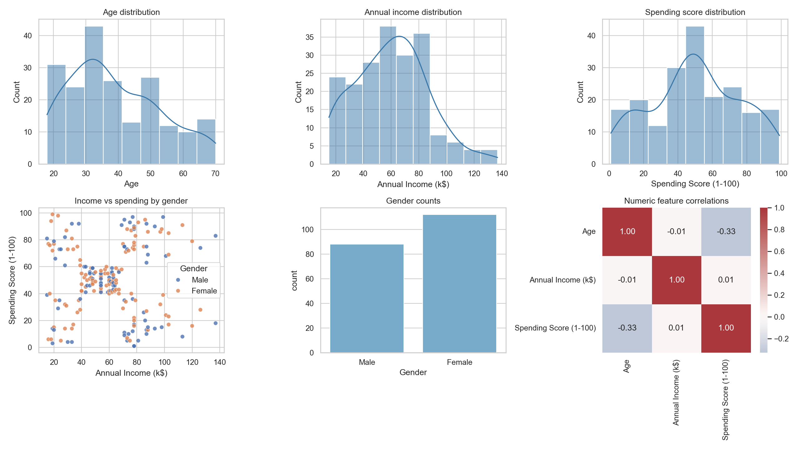
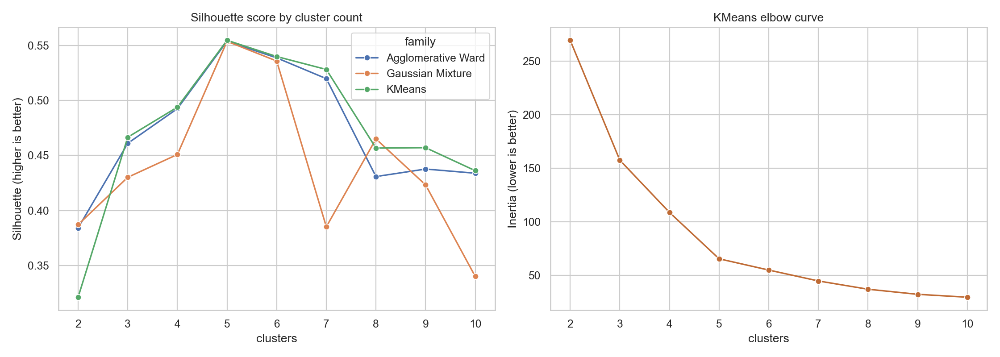
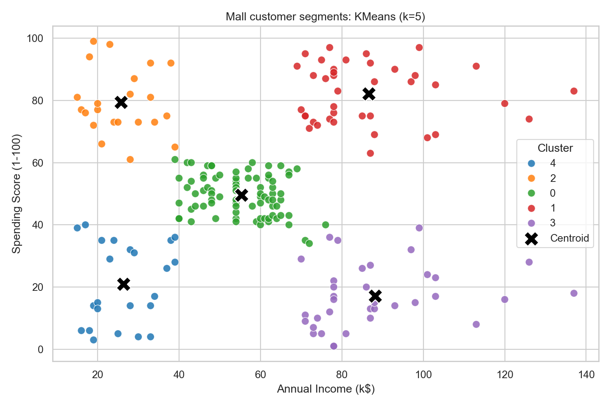

# Mall Customer EDA and Clustering

## Dataset and cleaning

- Source: `Mall_Customers.csv`; 200 input rows and 5 columns.
- Exact duplicate rows removed: 0.
- Rows after cleaning: 200; missing values: 0; duplicate customer IDs: 0.
- Numeric fields were parsed as numbers and the Gender text was trimmed and normalized.
- `CustomerID` is retained in the cleaned export but excluded from clustering because it is an identifier, not a customer behavior feature.
- Clustering uses standardized annual income and spending score. Standardization is important because the clustering algorithms use distances.

## Exploratory data analysis

- Gender counts: {'Female': 112, 'Male': 88}.
- Descriptive statistics:

| index | Age | Annual Income (k$) | Spending Score (1-100) |
| --- | --- | --- | --- |
| count | 200.0 | 200.0 | 200.0 |
| mean | 38.85 | 60.56 | 50.2 |
| std | 13.97 | 26.26 | 25.82 |
| min | 18.0 | 15.0 | 1.0 |
| 25% | 28.75 | 41.5 | 34.75 |
| 50% | 36.0 | 61.5 | 50.0 |
| 75% | 49.0 | 78.0 | 73.0 |
| max | 70.0 | 137.0 | 99.0 |

- Age is included in the EDA and segment profiles, but not in the primary clustering; the classic mall segmentation uses income and spending score, making segments directly interpretable on those axes.
- To assign new customers, enter their annual income and spending score in `New_Customers.csv`. The script uses the same scaler and KMeans model trained on this dataset and writes assigned groups to `new_customer_predictions.csv`. This assigns a segment; it does not measure prediction accuracy.

## Unsupervised model comparison

Models were evaluated on the same two standardized features. KMeans and Ward agglomerative clustering were tested for k=2 through 10; Gaussian Mixture models used 2 through 10 components; DBSCAN used `min_samples=5` and epsilon values 0.2 through 1.5.

| Metric | Interpretation |
| --- | --- |
| Silhouette | Higher is better; measures separation and cohesion. |
| Davies-Bouldin | Lower is better; compares within-cluster scatter with separation. |
| Calinski-Harabasz | Higher is better; compares between-cluster and within-cluster dispersion. |

Top fixed-partition candidates by silhouette:

| model | clusters | silhouette | davies_bouldin | calinski_harabasz |
| --- | --- | --- | --- | --- |
| KMeans (k=5) | 5 | 0.5547 | 0.5722 | 248.6493 |
| Agglomerative Ward (k=5) | 5 | 0.5538 | 0.5779 | 244.4103 |
| Gaussian Mixture (k=5) | 5 | 0.5537 | 0.576 | 244.9402 |
| KMeans (k=6) | 6 | 0.5399 | 0.6546 | 243.0879 |
| Agglomerative Ward (k=6) | 6 | 0.5387 | 0.6449 | 233.3088 |

The best useful fixed-partition result in this search is **KMeans with k=5**: silhouette **0.5547**, Davies-Bouldin **0.5722**, and Calinski-Harabasz **248.65**. At five clusters, Ward agglomerative and Gaussian Mixture scores were very close (silhouette around 0.554). KMeans has the slightly better silhouette on this run and provides simple, reproducible assignments.

DBSCAN is reported separately because its silhouette is calculated only on non-noise points. The highest DBSCAN silhouette candidate (DBSCAN (eps=0.2, min_samples=5)) labels 77 of 200 customers as noise, so the larger score is not a better overall segmentation of the full customer base.

## Selected customer segments

KMeans segment profiles (means; cluster labels are arbitrary identifiers):

| Cluster | customers | mean_age | mean_annual_income | mean_spending_score | gender_%_Female | gender_%_Male |
| --- | --- | --- | --- | --- | --- | --- |
| 0 | 81 | 42.72 | 55.3 | 49.52 | 59.26 | 40.74 |
| 1 | 39 | 32.69 | 86.54 | 82.13 | 53.85 | 46.15 |
| 2 | 22 | 25.27 | 25.73 | 79.36 | 59.09 | 40.91 |
| 3 | 35 | 41.11 | 88.2 | 17.11 | 45.71 | 54.29 |
| 4 | 23 | 45.22 | 26.3 | 20.91 | 60.87 | 39.13 |

## Conclusion

**Recommended for this dataset: KMeans with five clusters**, using standardized annual income and spending score. It has the highest silhouette among the tested fixed-partition models overall and the strongest five-cluster result across the three reported metrics, while assigning every customer to a segment. This is an internal clustering comparison, not supervised predictive accuracy: there are no ground-truth segment labels, so the scores do not establish an objective accuracy or guarantee business value. Review the segment profiles and validate them with business context before acting on them.

## Reproduce

Run `python mall_customer_analysis.py` in the folder containing `Mall_Customers.csv`. To assign new customers, fill in `New_Customers.csv` with the columns `Annual Income (k$)` and `Spending Score (1-100)`, then run the script. Results are written to `new_customer_predictions.csv` in the output folder.
